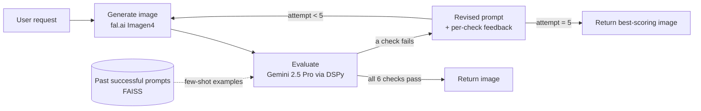

# Self-Correcting Text-to-Image Agent

An image generation agent that critiques its own output and rewrites the prompt until the image matches the request.
A vision LLM (Gemini 2.5 Pro) grades each image on six checks, and the agent regenerates with a revised prompt until every check passes or five attempts are used.

Built with FastAPI, DSPy, Gemini 2.5 Pro and fal.ai Imagen4.

## How it works



1. **Generate** an image from the user's prompt.
2. **Evaluate** it with a DSPy `Signature`. The LLM returns typed fields (a pass/fail per check, feedback per check, a revised prompt and a 1–10 score), so the stop condition is checked in code.
3. **Revise.** The previous prompt and its per-check feedback go into the next evaluation, so the same mistake is not repeated.
4. **Stop** when all six checks pass, or after 5 attempts. In that case the **best-scoring** image is returned, not the last one.
5. **Log** every attempt (prompt, verdicts, feedback, score) to `app/imagesdata/images_log.csv`.

### Evaluation checks

| Check | Question the evaluator answers | First-attempt pass rate |
|---|---|---|
| Overall intent | Does the image match the overall intent of the request? | 64% |
| Subject | Is the main subject correct? | 89% |
| Art type | Is the medium correct (illustration, photo, painting, logo…)? | 89% |
| Art style | Is the requested style applied (e.g. minimalism)? | 74% |
| Art movement | Is the requested movement or period applied (e.g. 1940s noir)? | 85% |
| No conflicts | Is the image free of contradictory elements? | 57% |

The 1–10 score is not part of the pass condition. It is used to pick the best image when no attempt passes, and for analysis.

## Results

From 74 logged runs (164 images). Verdicts and scores are the evaluator LLM's judgments.

| Metric | Result |
|---|---|
| Runs passing all 6 checks | 47% on the first attempt → 80% with the loop |
| Average score (38 runs that needed revision) | 5.9 first image → 8.7 best image |
| Average attempts to pass (24 runs passed after revision) | 2.5 |
| Runs that never passed: returning the best image instead of the last | average score 4.6 → 6.7 |

## Project structure

```
text2image_generation/
├── app/
│   ├── main.py                     # FastAPI entry point
│   ├── routers/                    # HTTP handlers
│   ├── services/dspy_optimization.py  # Generate → evaluate → revise loop
│   ├── models/                     # Image storage, CSV logging, prompt template
│   ├── data/                       # Prompt template
│   ├── imagesdata/images_log.csv   # Log of every attempt
│   ├── templates/, static/         # Web UI
├── rag/                            # Few-shot retrieval of past successful prompts
├── modelexperiment/                # Same prompt across 5 image models
├── test_pipeline.py                # Offline tests (no network, no API keys)
└── requirements.txt
```

## Setup

```bash
git clone https://github.com/kdlee02/text2image_generation.git
cd text2image_generation
uv venv && uv pip install -r requirements.txt
```

Create a `.env` file in the repo root (it is gitignored):

```
GEMINI_API_KEY=...    # evaluator
FAL_KEY=...           # image generation
UPSTAGE_API_KEY=...   # optional: embeddings for RAG few-shot retrieval
```

Without `UPSTAGE_API_KEY` the retrieval step is skipped and generation still works.

## Run

```bash
cd app
uv run python main.py
```

Open http://localhost:8000.

| Endpoint | Description |
|---|---|
| `POST /api/generate_image` | Body `{"user_input": "..."}`. Runs the loop and returns a base64 JPEG |
| `GET /api/get_images` | Generation history |
| `GET /api/get_csv_log` | Full CSV log |

## RAG few-shot retrieval (`rag/`)

Prompts from the log that scored above 8 **after being revised** by the loop are indexed in FAISS (Upstage embeddings).
For each new request, the 3 most similar are passed to the evaluator as examples of good revisions.

- The index is built once per process from the current log. Delete `rag/vectorstore/` to force a rebuild.
- Retrieval is best-effort. A missing key or empty index means no examples, never a failed generation.

Details: [rag/README.md](rag/README.md)

## Model comparison (`modelexperiment/`)

A CLI that sends the same prompt to Imagen4, Dreamina v3.1, Seedream v4, FLUX Pro v1.1 Ultra and Ideogram v3 through fal.ai and saves the outputs with generation times. Imagen4 was chosen as the default from this comparison.

Details: [modelexperiment/README.md](modelexperiment/README.md)

## Tests

```bash
uv run pytest test_pipeline.py
```

Offline and free. API calls are mocked. Covers best-image selection, unparseable scores, RAG failure fallback and the retrieval filter.

## Limitations

- **The evaluator is also the grader.** Pass rates and scores come from the same LLM that writes the revised prompt, and have not been checked against human ratings.
- **One generation model.** Imagen4 is fixed; routing by request type is not implemented.
