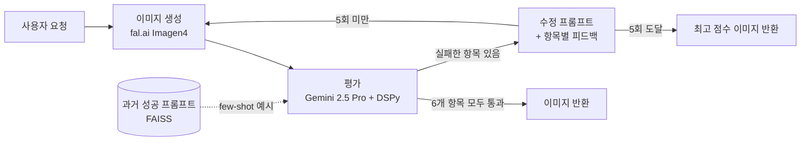

# 자기 수정 이미지 생성 에이전트

생성한 이미지를 스스로 평가하고, 요청과 맞을 때까지 프롬프트를 고쳐 다시 생성하는 에이전트입니다.
비전 LLM(Gemini 2.5 Pro)이 이미지마다 6개 항목을 판정하고, 모든 항목을 통과하거나 5회를 다 쓸 때까지 수정한 프롬프트로 다시 생성합니다.

FastAPI, DSPy, Gemini 2.5 Pro, fal.ai Imagen4로 만들었습니다.

## 동작 방식



1. **생성**: 사용자 프롬프트로 이미지를 만듭니다.
2. **평가**: DSPy `Signature`로 평가합니다. LLM이 항목별 통과 여부, 항목별 피드백, 수정 프롬프트, 1~10점 점수를 타입이 있는 필드로 돌려주기 때문에 종료 조건을 코드로 판정할 수 있습니다.
3. **수정**: 직전 프롬프트와 항목별 피드백을 다음 평가에 넘겨서 같은 실수를 반복하지 않게 합니다.
4. **종료**: 6개 항목을 모두 통과하거나 5회를 채우면 멈춥니다. 5회 안에 통과하지 못하면 마지막 이미지가 아니라 **점수가 가장 높은** 이미지를 반환합니다.
5. **기록**: 모든 시도의 프롬프트, 판정, 피드백, 점수를 `app/imagesdata/images_log.csv`에 남깁니다.

### 평가 항목

| 항목 | 평가자가 판단하는 내용 | 첫 시도 통과율 |
|---|---|---|
| 전체 의도 | 이미지가 요청의 전체 의도와 맞는가? | 64% |
| 주제 | 주 대상이 정확하게 표현됐는가? | 89% |
| 아트 타입 | 매체가 맞는가? (일러스트, 사진, 회화, 로고 등) | 89% |
| 아트 스타일 | 요청한 스타일이 반영됐는가? (예: 미니멀리즘) | 74% |
| 사조·시대 | 요청한 사조나 시대가 반영됐는가? (예: 1940년대 느와르) | 85% |
| 상충 요소 | 서로 모순되는 요소가 없는가? | 57% |

1~10점 점수는 통과 조건에 들어가지 않습니다. 끝까지 통과하지 못했을 때 반환할 이미지를 고르는 데와 분석에만 씁니다.

## 결과

로그에 남은 74회 실행(이미지 164장) 기준입니다. 통과 여부와 점수는 모두 평가 LLM의 판정입니다.

| 지표 | 결과 |
|---|---|
| 6개 항목 모두 통과한 실행 비율 | 첫 시도 47% → 루프 적용 후 80% |
| 평균 점수 (수정이 필요했던 38회) | 첫 이미지 5.9 → 최고 이미지 8.7 |
| 통과까지 평균 시도 횟수 (수정 후 통과한 24회) | 2.5회 |
| 끝까지 통과하지 못한 실행: 마지막 대신 최고 점수 이미지 반환 | 평균 점수 4.6 → 6.7 |

## 프로젝트 구조

```
text2image_generation/
├── app/
│   ├── main.py                     # FastAPI 진입점
│   ├── routers/                    # HTTP 핸들러
│   ├── services/dspy_optimization.py  # 생성 → 평가 → 수정 루프
│   ├── models/                     # 이미지 저장, CSV 로깅, 프롬프트 템플릿
│   ├── data/                       # 프롬프트 템플릿
│   ├── imagesdata/images_log.csv   # 전체 시도 로그
│   ├── templates/, static/         # 웹 UI
├── rag/                            # 과거 성공 프롬프트 few-shot 검색
├── modelexperiment/                # 같은 프롬프트로 이미지 모델 5개 비교
├── test_pipeline.py                # 오프라인 테스트 (네트워크, API 키 불필요)
└── requirements.txt
```

## 설치

```bash
git clone https://github.com/kdlee02/text2image_generation.git
cd text2image_generation
uv venv && uv pip install -r requirements.txt
```

저장소 루트에 `.env` 파일을 만듭니다. (gitignore에 포함되어 있습니다)

```
GEMINI_API_KEY=...    # 평가
FAL_KEY=...           # 이미지 생성
UPSTAGE_API_KEY=...   # 선택: RAG few-shot 검색용 임베딩
```

`UPSTAGE_API_KEY`가 없으면 검색 단계만 건너뛰고 생성은 그대로 동작합니다.

## 실행

```bash
cd app
uv run python main.py
```

http://localhost:8000 에 접속합니다.

| 엔드포인트 | 설명 |
|---|---|
| `POST /api/generate_image` | Body `{"user_input": "..."}`. 루프를 실행하고 base64 JPEG를 반환 |
| `GET /api/get_images` | 생성 기록 |
| `GET /api/get_csv_log` | 전체 CSV 로그 |

## RAG few-shot 검색 (`rag/`)

로그에서 루프를 거쳐 **수정된 뒤** 8점을 넘긴 프롬프트만 FAISS에 인덱싱합니다. (Upstage 임베딩)
새 요청이 들어오면 가장 비슷한 3개를 좋은 수정 예시로 평가자에게 넘깁니다.

- 인덱스는 프로세스마다 한 번, 현재 로그로 만듭니다. 다시 만들려면 `rag/vectorstore/`를 지우면 됩니다.
- 검색은 실패해도 괜찮게 설계했습니다. 키가 없거나 인덱스가 비어 있으면 예시 없이 진행할 뿐, 생성이 실패하지는 않습니다.

자세한 내용: [rag/README.md](rag/README.md)

## 모델 비교 (`modelexperiment/`)

같은 프롬프트를 fal.ai로 Imagen4, Dreamina v3.1, Seedream v4, FLUX Pro v1.1 Ultra, Ideogram v3에 보내고 결과와 생성 시간을 저장하는 CLI입니다. 이 비교를 바탕으로 Imagen4를 기본 모델로 정했습니다.

자세한 내용: [modelexperiment/README.md](modelexperiment/README.md)

## 테스트

```bash
uv run pytest test_pipeline.py
```

오프라인으로 돌아가고 비용이 들지 않습니다. API 호출은 mock으로 대체합니다. 최고 점수 이미지 선택, 파싱할 수 없는 점수, RAG 실패 시 대체 동작, 검색 필터를 테스트합니다.

## 한계

- **평가자가 채점도 합니다.** 통과율과 점수는 수정 프롬프트를 쓰는 LLM이 직접 매긴 것이고, 사람 평가와 비교해 검증하지 않았습니다.
- **생성 모델이 하나입니다.** Imagen4로 고정되어 있고, 요청 유형에 따라 모델을 고르는 기능은 없습니다.
